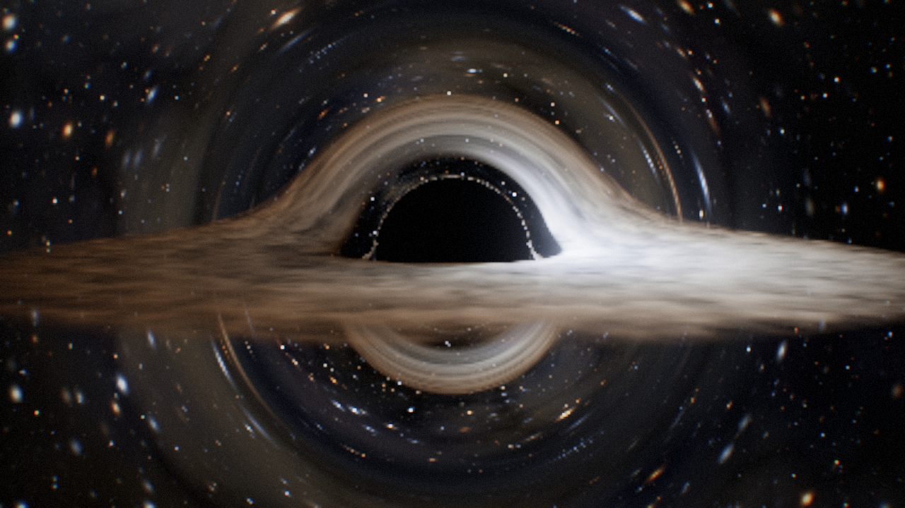
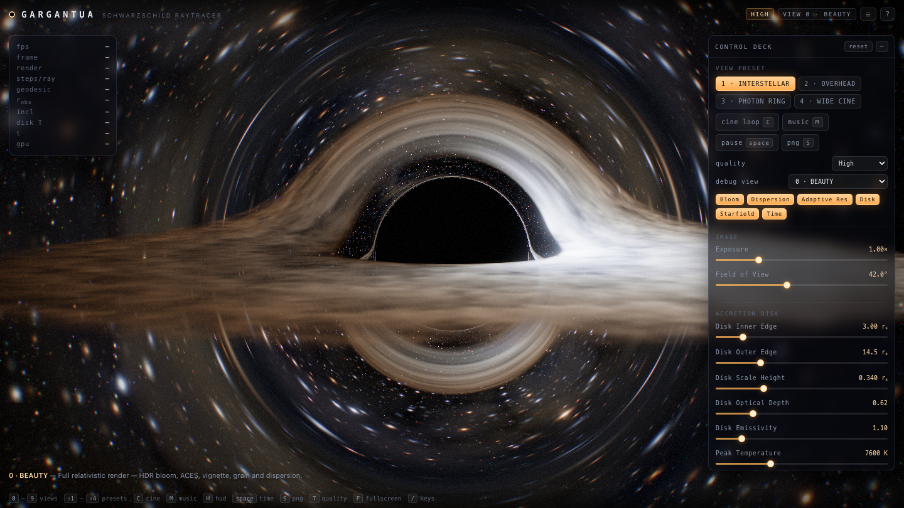
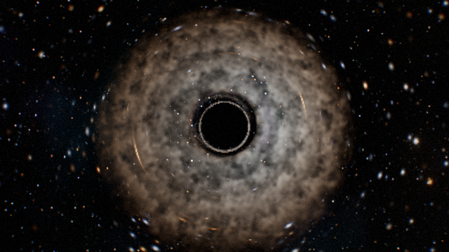
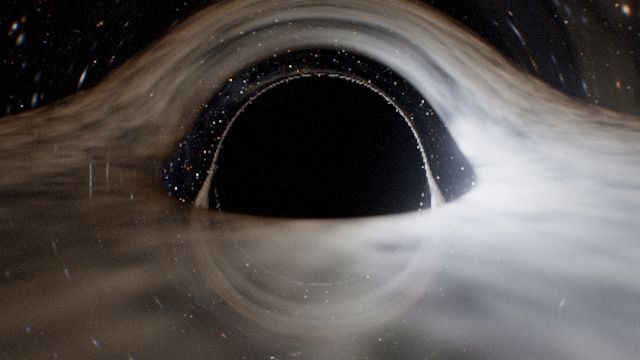
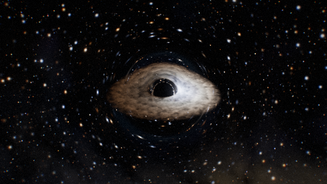
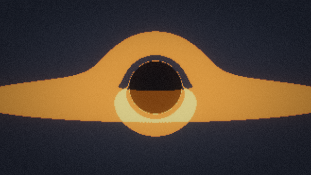
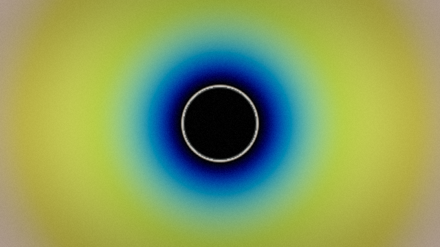
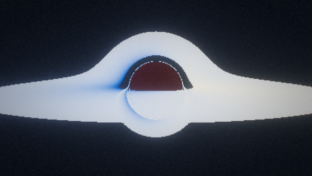
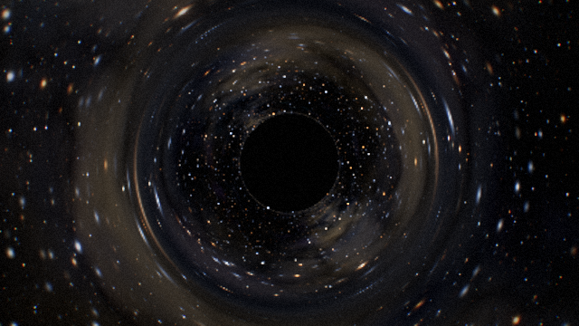

# GARGANTUA — Schwarzschild Black Hole Raytracer



**A real-time black hole, integrated per pixel.** Every pixel fires a null
geodesic of the Schwarzschild metric and integrates it on the GPU. The accretion
disk, the photon ring, the event-horizon shadow and the lensed star field are
all computed from that integration — there is **no black sphere, no textured
ring, no video and no pre-rendered image** anywhere in the render path.

[](LICENSE)


### [▶ Live demo](https://sun-sh902.github.io/gargantua/) · [Source](https://github.com/Sun-sh902/gargantua)

Plain HTML + CSS + ES modules and a vendored copy of three.js. **No build
step, no npm install, no network access at run time.**

```bash
git clone https://github.com/Sun-sh902/gargantua.git && cd gargantua
node tools/serve.mjs          # → http://127.0.0.1:8123/
```

(or any static server: `python3 -m http.server 8123`)

### What you can do with it

| | |
| --- | --- |
| **Orbit the hole** | drag / wheel / pinch — damped OrbitControls, 4 cinematic presets, `C` for a keyframed camera loop |
| **Break the physics open** | 21 live parameters: disk temperature, optical depth, Doppler beaming, redshift, turbulence, sky, bloom… |
| **See the machinery** | `0`–`9` debug views: integration cost, disk-crossing count, redshift factor, impact parameter, optical depth… |
| **Capture anything** | `S` for a PNG, or the whole `?shot=1&preset=2&debug=6` URL automation surface |
| **Run anywhere** | Standard / High / Cinematic tiers, mobile layout, Retina, adaptive resolution, WebGL context-loss recovery |



---

## 1. What is actually being computed

### 1.1 The geodesic

Units are chosen so that the Schwarzschild radius is `r_s = 2M = 1`. A photon's  
orbit always lies in the plane spanned by the observer's position and the ray  
direction, so the whole 3-D trajectory collapses to one ODE for `u = 1/r` as a  
function of the longitude `φ` in that plane:

```
d²u/dφ² = −u + 3M u²   =   −u + 1.5 u²
```

This is integrated per pixel with classical RK4 (`src/glsl/blackhole.js`).  
Everything else falls out of the same flow:

| Quantity              | How it is obtained                                                                       |
| --------------------- | ---------------------------------------------------------------------------------------- |
| Event horizon         | `u ≥ 1` → the photon is captured; the pixel is left **pure black**                       |
| Photon sphere / ring  | rays that wind near `r = 3M = 1.5 r_s` before escaping                                   |
| Gravitational lensing | the escaped photon's asymptotic direction is used to look up the sky                     |
| Multiple disk images  | every sign change of the disk-plane coordinate `y(φ)` is refined by bisection and shaded |
| Impact parameter      | `b = L/E = 1/√(u² + u′² − u³)`, a conserved quantity                                     |
| Redshift factor       | `g = √(1 − 3M/r) / (1 − Ω b_Y)`, `Ω = √(M/r³)`                                           |

Two numerical details matter and both are commented in the shader:

- **The far-field direction is computed analytically.** In the far field the ODE  
  reduces to `u = C·sin(φ − φ∞)`, so `φ∞ = φ − atan2(u, u′)` is the exact  
  direction of travel at infinity. Using the instantaneous tangent at a finite  
  escape radius leaves a residual bend of order `b/r` (up to 3°) that jumps  
  discontinuously from pixel to pixel and etches concentric rings into the sky.
- **The horizon test is done on `u`, never on `r = 1/u`.** A single φ-step in  
  the far field can push `u` through zero; `r` then comes back *negative* and an  
  `r ≤ 1` test misreads it as "captured", painting dark rings wherever the step  
  phase happens to land. `src/glsl/blackhole.js` carries the full explanation.

### 1.2 The accretion disk

A thin, flared, semi-transparent slab in the `y = 0` plane, sampled only where  
the geodesic crosses it:

- **Temperature** — Shakura–Sunyaev / Novikov–Thorne profile  
  `T ∝ (r_in/r)^{3/4}·(1 − √(r_in/r))^{1/4}`, peak at `r = 49/36 r_in`,  
  normalised, then mapped through a Planckian locus to linear sRGB.
- **Radiometry** — `I_obs = g⁴ · B(T·g)`: Doppler beaming and gravitational  
  redshift are applied to both the intensity and the colour temperature, so the  
  approaching side is bright and blue while the receding side is dim and red.  
  Both are exposed as separate artistic multipliers.
- **Transfer** — each crossing contributes `α = 1 − e^{−τ}` and attenuates what  
  is behind it, so higher-order images are correctly dimmed and the black hole  
  stays genuinely black.
- **Geometry** — the slab half-thickness flares as `H ∝ r^{1.15}` and the  
  optical depth scales with the geometric path length `1/|cos i|`, so the disk  
  brightens at grazing incidence.
- **Turbulence** — simplex fBm advected by the Keplerian shear `Ω(r)`, with the  
  *differential* part of the shear saturating (tanh) so a long session produces  
  spiral arms instead of winding itself into numerical mush. Surface density  
  rises inward so the hot inner rings stay optically thick while the cooler  
  outer flow stays semi-transparent and shows its filaments.

### 1.3 The sky

Procedural 3-D simplex noise builds a Milky Way band (with ridged dust lanes and  
a galactic bulge) and faint emission nebulae; four magnitude/density layers of  
stars are placed in hash cells and sized in *pixels* so they stay anti-aliased.  
Because the sky is sampled along the **lensed** escape direction, the galactic  
band wraps around the shadow into Einstein rings for free.

---

## 2. Controls

| Key                  | Action                                  |
| -------------------- | --------------------------------------- |
| `0` – `9`            | debug view (see §5)                     |
| `⇧` + `1` – `4`      | camera preset                           |
| `C`                  | cinematic camera loop                   |
| drag / wheel / pinch | orbit and zoom (OrbitControls, damped)  |
| `space`              | pause / resume simulation time          |
| `,` `.`              | time scale −/+                          |
| `[` `]`              | exposure −/+                            |
| `-` `=`              | field of view −/+                       |
| `B`                  | bloom on/off                            |
| `S`                  | save the current frame as PNG           |
| `T`                  | cycle quality tier                      |
| `H`                  | hide/show the HUD                       |
| `Tab`                | collapse the control deck               |
| `M`                  | ambient music                           |
| `F`                  | fullscreen                              |
| `R` / `⇧R`           | reset the camera / reset all parameters |
| `/` or `?`           | shortcut sheet, `esc` closes            |

Touching the scene with a pointer or the wheel cancels the cinematic loop and  
hands control back to OrbitControls.

---

## 3. The 21 parameters

| #  | Group          | Parameter              | Default            |
| -- | -------------- | ---------------------- | ------------------ |
| 1  | Image          | Exposure               | 1.00×              |
| 2  | Image          | Field of View          | 40°                |
| 3  | Accretion disk | Disk Inner Edge        | 3.00 r_s (ISCO)    |
| 4  | Accretion disk | Disk Outer Edge        | 14.5 r_s           |
| 5  | Accretion disk | Disk Scale Height      | 0.340 r_s          |
| 6  | Accretion disk | Disk Optical Depth     | 0.62               |
| 7  | Accretion disk | Disk Emissivity        | 1.10               |
| 8  | Accretion disk | Peak Temperature       | 7600 K             |
| 9  | Relativity     | Doppler Beaming        | 1.00× (0 disables) |
| 10 | Relativity     | Gravitational Redshift | 1.00× (0 disables) |
| 11 | Turbulence     | Turbulence Scale       | 0.420              |
| 12 | Turbulence     | Turbulence Speed       | 1.00×              |
| 13 | Turbulence     | Turbulence Contrast    | 1.00               |
| 14 | Deep sky       | Star Density           | 1.00×              |
| 15 | Deep sky       | Star Brightness        | 1.00×              |
| 16 | Deep sky       | Galaxy Luminance       | 1.00×              |
| 17 | Deep sky       | Nebula Emission        | 1.00×              |
| 18 | Post           | Bloom Strength         | 0.45               |
| 19 | Post           | Bloom Threshold        | 1.10               |
| 20 | Post           | Vignette               | 0.55               |
| 21 | Post           | Film Grain             | 0.050              |

Plus non-slider extras: **orbital direction** (prograde/retrograde) and the  
boolean toggles *Bloom, Dispersion, Adaptive Res, Disk, Starfield, Time*.

Every parameter, the quality tier, the debug view, the preset, the HUD state  
and the music flag persist to `localStorage` (flushed on `pagehide` too).

---

## 4. Post-processing

Hand-written, no postprocessing addons:

1. the geodesic pass renders into an **RGBA16F** target;
2. a soft-knee threshold + 4-tap prefilter feeds a **13-tap downsample** chain  
   (4–6 mips depending on tier);
3. a **9-tap tent upsample** adds the chain back together;
4. the final pass does dispersion (per-channel radial offset), HDR composite,  
   **ACES** (Stephen Hill's fit), vignette, film grain in display space,  
   sRGB encoding and dithering.

---

## 5. Debug views

| Key | View              | What it shows                                                                 |
| --- | ----------------- | ----------------------------------------------------------------------------- |
| 0   | Beauty            | the full render                                                               |
| 1   | Integration cost  | RK4 steps consumed per ray — red is the full budget, i.e. the winding region  |
| 2   | Disk crossings    | how many times each photon crossed the equatorial plane (higher-order images) |
| 3   | Redshift factor g | ν_obs/ν_emit at the last crossing, blue = approaching                         |
| 4   | Newtonian disk    | lensing geometry with beaming and redshift switched off                       |
| 5   | Lensed sky        | background only — the Einstein rings of the galactic band                     |
| 6   | Impact parameter  | b against the critical value 3√3 M = 2.598 r_s                                |
| 7   | Temperature map   | observed blackbody temperature of the disk surface                            |
| 8   | Bloom buffer      | the bloom pyramid alone                                                       |
| 9   | Optical depth     | accumulated disk absorption plus the pure-black capture mask                  |

---

## 6. Quality tiers, DPI and robustness

| Tier      | Steps/ray | dφ    | Bloom mips | Render scale | Pixel budget |
| --------- | --------- | ----- | ---------- | ------------ | ------------ |
| Standard  | 320       | 0.055 | 4          | 0.72         | 1.25 MP      |
| High      | 640       | 0.038 | 5          | 1.00         | 2.6 MP       |
| Cinematic | 1150      | 0.024 | 6          | 1.00         | 4.6 MP       |

- The tier is auto-detected from the user agent, core count and screen area;  
  a `?quality=` parameter overrides it.
- The render target is decoupled from the canvas: mobiles, Retina displays and  
  large monitors all respect a pixel budget, and an adaptive scaler trades  
  resolution for frame rate between 0.34× and the tier target.
- OrbitControls gives touch support; the control deck docks to the bottom of  
  the screen under 720 px, and the telemetry panel hides itself.
- **Context loss** is handled: `webglcontextlost` raises an overlay, the loop  
  parks, and `webglcontextrestored` rebuilds the post pipeline and resumes.
- The frame scheduler uses `requestAnimationFrame` with a timer watchdog, so a  
  throttled or offscreen surface cannot freeze the simulation silently.

---

## 7. Screenshot automation

Any of the 21 parameters can be set from the query string, plus:

| Parameter                                        | Meaning                                                              |
| ------------------------------------------------ | -------------------------------------------------------------------- |
| `shot=1`                                         | deterministic capture mode: HUD hidden, camera loop off, time frozen |
| `t=3.5`                                          | set the simulation clock (seconds) before rendering                  |
| `preset=0…3`                                     | camera preset                                                        |
| `quality=standard\|high\|cinematic`              | quality tier                                                         |
| `debug=0…9`                                      | debug view                                                           |
| `hud=0\|1`, `cine=0\|1`, `music=0\|1`, `pause=1` | interface flags                                                      |
| `frames=N`                                       | frames to render before `ready` resolves                             |
| `scale=0.5`                                      | pin the render scale (useful for headless GPUs)                      |

The page exposes `window.GARGANTUA`:

```js
await window.GARGANTUA.ready;              // resolves once frames have rendered
window.GARGANTUA.setParams({ exposure: 1.4, diskTemp: 9000 });
window.GARGANTUA.setPreset(2);
window.GARGANTUA.setDebug(6);
window.GARGANTUA.setQuality('cinematic');
window.GARGANTUA.setTime(12.5);
window.GARGANTUA.stats();                  // fps, r, inclination, params, errors…
window.GARGANTUA.render();                 // render exactly one frame
await window.GARGANTUA.capture(4);         // → "data:image/png;base64,…"
```

### Headless capture CLI

```
node tools/serve.mjs &
node tools/capture.mjs --url "http://127.0.0.1:8123/?shot=1&hud=0&preset=2" \
                       --out shots/ring.png --width 1920 --height 1080 --wait 60000
```


`tools/capture.mjs` drives Chrome over raw CDP with no dependencies, collects
console errors / uncaught exceptions / failed requests, decodes the PNG itself
and reports the luminance so a black frame is detected automatically.
Exit codes: `0` clean, `2` page errors, `3` black frame, `1` harness failure.

---

## 8. Project layout

```
index.html                 shell + HUD markup + import map
styles.css                 HUD / overlay styling, mobile breakpoints
src/
  main.js                  boot, render loop, input, automation API, recovery
  config.js                the 21 parameters, presets, quality tiers, debug views
  state.js                 store, persistence, URL parsing
  hud.js                   HUD built from config.js
  camera.js                OrbitControls rig, preset tweens, cinematic loop
  audio.js                 ambient drone (file first, live WebAudio fallback)
  glsl/
    lib.js                 hashes, simplex noise, fBm, blackbody, heatmaps
    blackhole.js           the geodesic raytracer (the heart of the project)
    post.js                prefilter / downsample / upsample / ACES composite
  renderer/
    raytracer.js           the full-screen quad + uniform plumbing
    postfx.js              HDR render targets and the bloom pyramid
vendor/three/              three.js r160 + OrbitControls (MIT)
assets/audio/              ambient-drone.wav — 30 s seamless loop
tools/
  serve.mjs                zero-dependency static server
  capture.mjs              headless screenshot + console harness
  make-audio.mjs           deterministic ambient-drone generator
tests/
  acceptance.mjs           end-to-end UI/API/recovery acceptance run
  geodesic-probe.mjs       double-precision ODE probe + error table
  geodesic-f32-probe.mjs   float32 emulation of the shader's loop
```

---

## Gallery

The four camera presets, rendered straight out of the shader:

| INTERSTELLAR — near edge-on | OVERHEAD — down the rotation axis |
| --- | --- |
|  |  |
| **PHOTON RING — 8.5 r_s close approach** | **WIDE — establishing shot at 52 r_s** |
|  |  |

Four of the ten debug views — disk-crossing count, impact parameter against the
critical curve 3√3 M, the redshift factor and the lensed sky:

|  |  |
| --- | --- |
|  |  |

Every frame here was produced by `tests/visual-matrix.mjs`, which also asserts
that none of them is a black screen.

---

## 9. Testing

```
node tools/serve.mjs &
node tests/acceptance.mjs            # 34 checks: boot, shortcuts, API, persistence,
                                     # mobile layout, context loss, console cleanliness
node tests/visual-matrix.mjs         # 21 renders: 4 presets, 10 views, 3 tiers,
                                     # 4 parameter extremes — no black frames
node tests/geodesic-probe.mjs        # RK4 step-size / deflection-accuracy table
node tests/geodesic-f32-probe.mjs    # float32 emulation of the shader loop
node tools/make-audio.mjs --verify   # re-parses the shipped WAV and re-checks it
```

Results of the last full run are in [`TESTING.md`](TESTING.md).

---

## 10. Credits

three.js r160 (MIT) is vendored under `vendor/three/`; 3-D simplex noise is
Ashima Arts / Stefan Gustavson (MIT); the ACES fit is Stephen Hill's. Everything
else — geodesic integrator, disk model, sky, bloom chain and HUD — is written
for this project and released under the [MIT License](LICENSE).
See [NOTICE](NOTICE) for the full third-party attributions.
